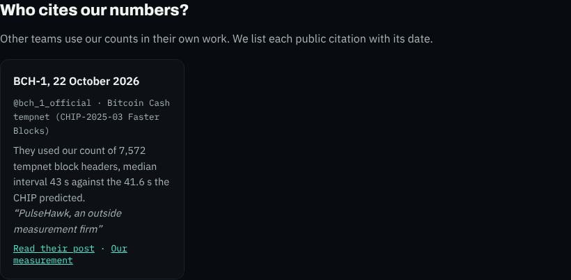
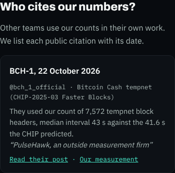
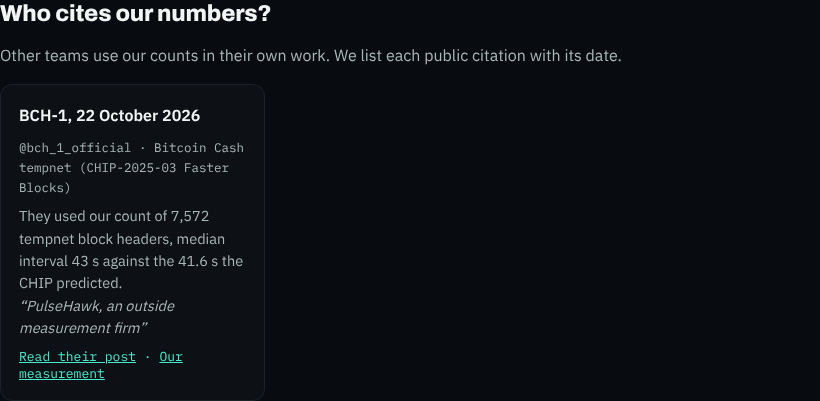
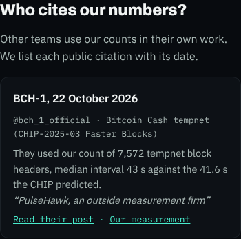
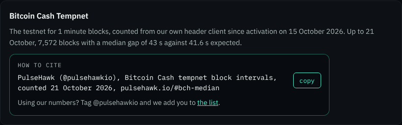
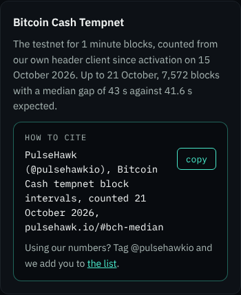
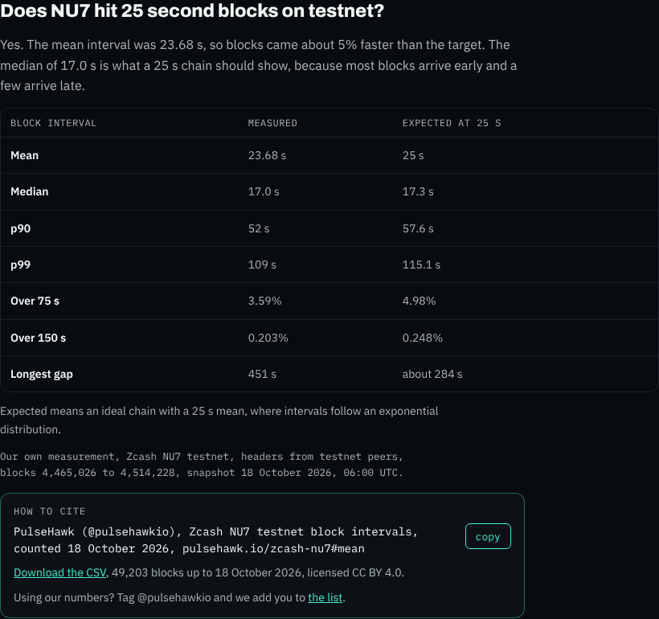
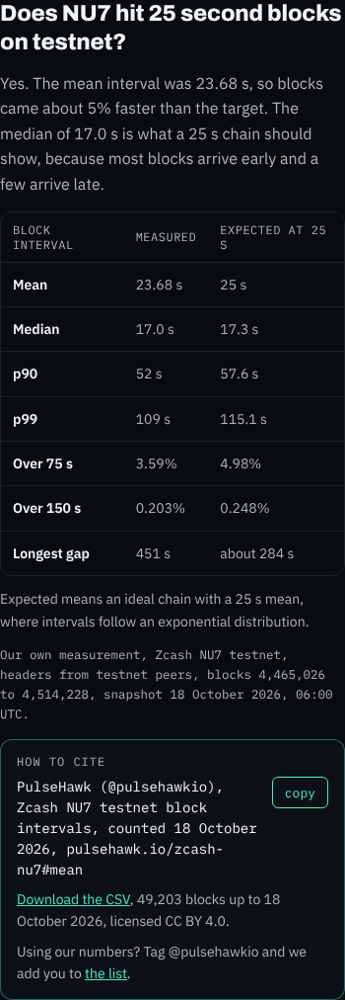
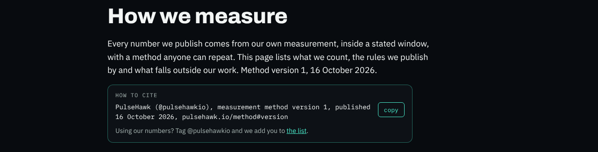
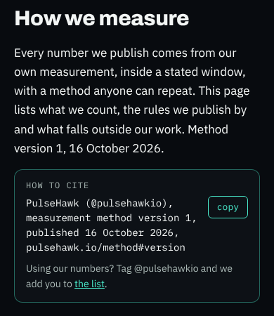

# Bericht 23.10.2026, "Who cites our numbers?"

Auftrag von Ben vom 23.10.2026, umgesetzt in einem PR, #36 (Branch `site/cited-by`), offen.

## Was gemacht wurde
- **`data/citations.json` neu.** Felder je Eintrag: `date`, `source_name`, `source_handle`, `url`, `network`, `what_they_used`, `quote`, `our_page`.
- **Erster Eintrag:** BCH-1 (`@bch_1_official`), 22.10.2026.
  - Netzwerk: Bitcoin Cash tempnet (CHIP-2025-03 Faster Blocks).
  - Genutzt haben sie unsere Zählung von 7,572 Tempnet-Blockköpfen, Median 43 s gegen die 41.6 s, die der CHIP vorhersagt.
  - Zitat: "PulseHawk, an outside measurement firm".
  - `our_page` ist `/#bch-median`, der Anker an der Bitcoin-Cash-Karte auf der Startseite. Eine eigene Seite zur Tempnet-Messung gibt es nicht.
  - `type` ist `post`, `tagged` ist `false` (siehe offene Fragen).
- **`scripts/b2b_pages.py`** baut den Abschnitt aus der Datei. Er prüft jeden Eintrag und bricht den Build ab, wenn eines davon zutrifft:
  - ein Pflichtfeld fehlt
  - das Datum ist ungültig
  - die URL beginnt nicht mit https
  - das Zitat hat mehr als 8 Wörter
  - `our_page` ist keine eigene Seite

  Neue Einträge brauchen also keine Code-Änderung: Eintrag ergänzen, dann `python3 scripts/b2b_pages.py` laufen lassen.
- **Startseite:** "Who cites our numbers?" steht direkt unter "Which networks have we measured?". Gezeigt werden höchstens 3 Einträge, die neuesten zuerst. Ab dem vierten Eintrag erscheint ein Link "All N citations" auf `/independence#cited-by`.
- **`/independence`:** Dort steht die ganze Liste unter derselben Überschrift, vor den Fragen.
- **Satz unter der Überschrift:** "Other teams use our counts in their own work. We list each public citation with its date."
- **Aufbau der Karte:**
  - Name und Datum
  - Konto und Netzwerk
  - "They used ..."
  - das Zitat in Anführungszeichen
  - ein Link auf die Quelle, öffnet in neuem Tab (`target="_blank" rel="noopener"`). Der Text hängt an `type`, siehe Ergänzung.
  - "Our measurement", nur wenn `our_page` gesetzt ist
- **Was die Karte nicht hat:** kein Logo, kein Bild, kein Lob.
- **CSS:** Die Zitatkarte nutzt nur vorhandene Klassen. Der Zitierkasten aus der Ergänzung braucht neue Klassen. Weil die CSS in jeder Seite steht, ändert sich deshalb bei allen 13 Seiten die Stilzeile. Der Inhalt ändert sich nur auf `/`, `/independence`, `/zcash-nu7` und `/method`. Nur diese vier haben ein neues `lastmod` in der Sitemap.
- **`_config.yml`:** gleicher Inhalt wie in #34, damit `berichte/` nicht auf pulsehawk.io landet, egal welcher PR zuerst gemergt wird.

## Ergänzung vom 23.10.2026 abends (gleicher PR)
- **"How to cite" unter der Hauptzahl.** Der Kasten enthält den fertigen Satz und den Knopf "copy". Bei Zcash kommen der Link zur CSV und in jedem Fall der Satz "Using our numbers? Tag @pulsehawkio and we add you to the list." dazu, "the list" verlinkt auf `/independence#cited-by`. Die Sätze lauten wörtlich:
  - `/zcash-nu7`, unter der Tabelle: "PulseHawk (@pulsehawkio), Zcash NU7 testnet block intervals, counted 18 October 2026, pulsehawk.io/zcash-nu7#mean". Darunter "Download the CSV, 49,203 blocks up to 18 October 2026, licensed CC BY 4.0." Der Link trägt dieselbe Klasse wie der Download-Knopf, Plausible zählt ihn also als CSV Download.
  - Startseite, in der Bitcoin-Cash-Karte: "PulseHawk (@pulsehawkio), Bitcoin Cash tempnet block intervals, counted 21 October 2026, pulsehawk.io/#bch-median". Ohne CSV-Zeile, weil zur Tempnet-Zählung keine CSV in diesem Repo liegt. Die Karte geht jetzt über die ganze Breite, sonst würden die Karten daneben mit hoch gezogen.
  - `/method`, direkt unter dem Einleitungstext: "PulseHawk (@pulsehawkio), measurement method version 1, published 16 October 2026, pulsehawk.io/method#version". Hier steht "published" statt "counted", weil "counted" nach unserer Textregel nur für eigene Zählungen steht und eine Methode keine Zählung ist. Ohne CSV-Zeile, weil die Methodenseite keine eigenen Daten hat.
  - `/cases/kaspa` bekommt keinen Kasten. Dort stammt keine Zahl aus einer eigenen Zählung, alles ist "source" oder Protokollwert.
  - Künftige Fallseiten rufen `zitier_kasten()` im Generator auf. Das ist eine Zeile pro Seite.
- **Feste Anker.**
  - `/zcash-nu7`: jede Tabellenzeile (`#mean`, `#median`, `#p90`, `#p99`, `#over-75s`, `#over-150s`, `#longest-gap`) und die Abschnitte `#slow-blocks`, `#difficulty`, `#confirmations`, `#orphaned`.
  - `/method#version` und `/#bch-median`.
  - Eine angesprungene Tabellenzeile wird leicht hinterlegt.
- **`citations.json`** hat zwei neue Pflichtfelder.
  - `type` ist `article`, `forum`, `video`, `podcast` oder `post`. Er bestimmt den Linktext: "Read their article", "Read their forum post", "Watch their video", "Hear their podcast" oder "Read their post". Damit ist die frühere Frage "article oder post" erledigt, BCH-1 zeigt "Read their post".
  - `tagged` ist `true` oder `false`. Es wird nicht angezeigt.
  - Ein fehlendes oder falsches Feld bricht den Build ab.
- **Zähler "Cited N times since October 2026"** über der Überschrift, auf der Startseite und auf `/independence`. Er erscheint erst ab 3 Einträgen, der Monat ist der des ältesten Eintrags. Bei einem Eintrag steht er nicht da, getestet mit 2, 3 und 4 Einträgen im Generator.
- **`b2b_check.py`** prüft jetzt auch den Kasten:
  - Satzform
  - Anker vorhanden auf der Zielseite
  - Knopf gehört zum Satz
  - Einladungssatz vorhanden
  - keine doppelte id auf einer Seite

  Dazu gelten die bisherigen Textregeln auch für den Zitier- und den Einladungssatz. Gegenproben mit falschem Anker, falscher Form, fehlendem Einladungssatz, falschem Knopf, doppelter id, Doppelpunkt und Gedankenstrich melden jeweils einen Fund.

## Prüfungen
- `data/citations.json` ist valide, `b2b_check` 0 von 13 Seiten mit Funden, auch mit den neuen Kastenregeln.
- **Knopf "copy" in Chromium:** Auf `/zcash-nu7`, `/method` und `/` liegt nach dem Klick genau der Satz in der Zwischenablage, über die Clipboard-API und, mit abgeschalteter API, über den Ersatzweg. Der Knopf zeigt 2 s lang "copied". Ein Screenreader hört "Copied to clipboard".
- **Safari nicht im Browser geprüft.** In der Claude-Umgebung gibt es nur Chromium, WebKit lässt sich hier nicht installieren. Der Code nutzt den Weg, den Safari ab 13.1 kann (`navigator.clipboard.writeText` direkt im Klick). Scheitert das, kopiert ein unsichtbares Textfeld. Klappt auch das nicht, bleibt der Satz markiert, und man kopiert von Hand.
- **Anker:** `/zcash-nu7#mean`, `#median`, `#difficulty`, `/method#version`, `/#bch-median` und `/independence#cited-by` springen jeweils so, dass das Ziel 16 px unter dem oberen Rand steht.
- Lighthouse lokal für `/`, `/zcash-nu7` und `/method`: 100/100/100/100, Handy und Desktop.
- Seitenstempel-Selbsttest 282 von 282, Secret-Scan ohne Fund.
- Lighthouse lokal für `/` und `/independence`: 100/100/100/100, Handy und Desktop.
- Kein waagerechtes Scrollen bei 390 und 1280 px. Der Link trägt `_blank` und `noopener`.
- **Link nicht geprüft:** x.com ist aus der Claude-Umgebung gesperrt (Proxy-Ablehnung, DNS-Fehler). Es gab keinen HTTP-Status, und auch über Ausweich-Dienste kam keine Seite.

## Screenshots
Startseite, 1280 px:

Startseite, 390 px:

`/independence`, 1280 px:

`/independence`, 390 px:

Zitierkasten auf der Startseite, 1280 px und 390 px:

Zitierkasten auf `/zcash-nu7`, 1280 px und 390 px:

Zitierkasten auf `/method`, 1280 px und 390 px:

## Offene Fragen an Ben
1. **Wortlaut des Zitats:** Steht "PulseHawk, an outside measurement firm" genau so im Post? Gegen das Original habe ich es nicht prüfen können (siehe oben).
2. **`tagged` bei BCH-1:** Steht im Post `@pulsehawkio`? Ich habe `false` eingetragen, weil ich den Post nicht öffnen kann.
3. **Fallseite:** Soll es eine Seite zur Bitcoin-Cash-Tempnet-Messung geben? Dann bekäme sie den Kasten mit CSV-Zeile, und `our_page` zeigt auf sie statt auf `/#bch-median`.
4. **Zcash, zwei Zitierformen:** Unter dem Download-Knopf steht weiter die Lizenzzeile aus #30, "Cite as PulseHawk (2026), Zcash NU7 testnet block intervals, cut-off 18 October 2026." Der neue Kasten zitiert anders. Soll die Lizenzzeile auf "Data from PulseHawk, licensed CC BY 4.0." gekürzt werden, damit es nur eine Zitierform gibt?
5. **Methodenseite:** Ist "published" statt "counted" so recht?
6. **Länge der Liste auf `/independence`:** Der Prüfer erlaubt höchstens 250 Wörter je Abschnitt. Eine Karte hat etwa 40 Wörter, also meldet er ab etwa 6 Zitaten einen Fund. Dann zeigt `/independence` die Liste entweder in Teilen, etwa nach Monat, oder die Liste wird von der Regel ausgenommen.

## Was Ben tun muss
1. Den Post öffnen, Wortlaut, Zahlen und `tagged` bestätigen, dann #36 mergen.
2. Nach dem Merge auf dem iPhone oder Mac in Safari einmal "copy" auf pulsehawk.io/zcash-nu7 drücken und den Satz irgendwo einfügen.
3. Weitere Zitate als Eintrag in `data/citations.json` ergänzen und `python3 scripts/b2b_pages.py` laufen lassen, oder Claude damit beauftragen.
