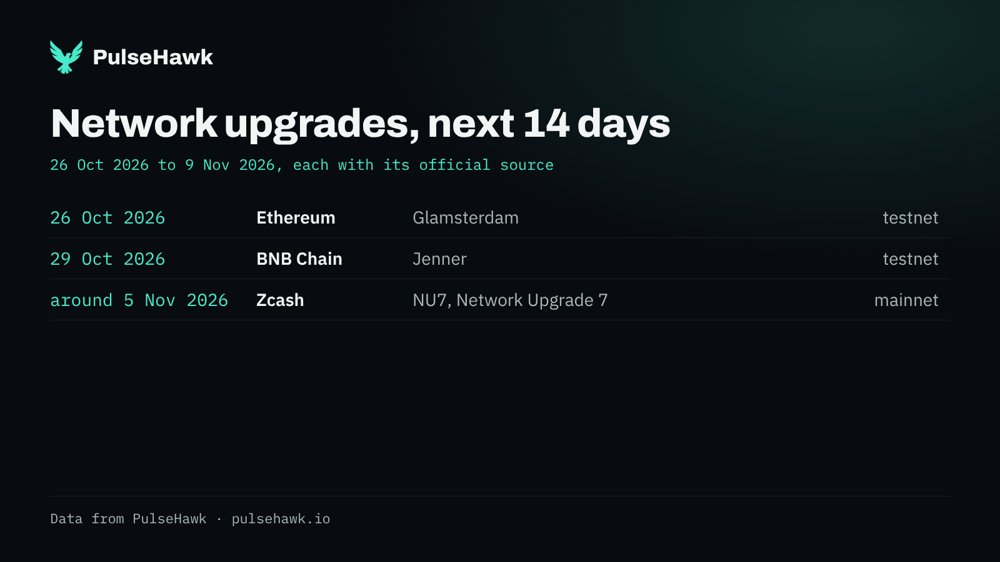
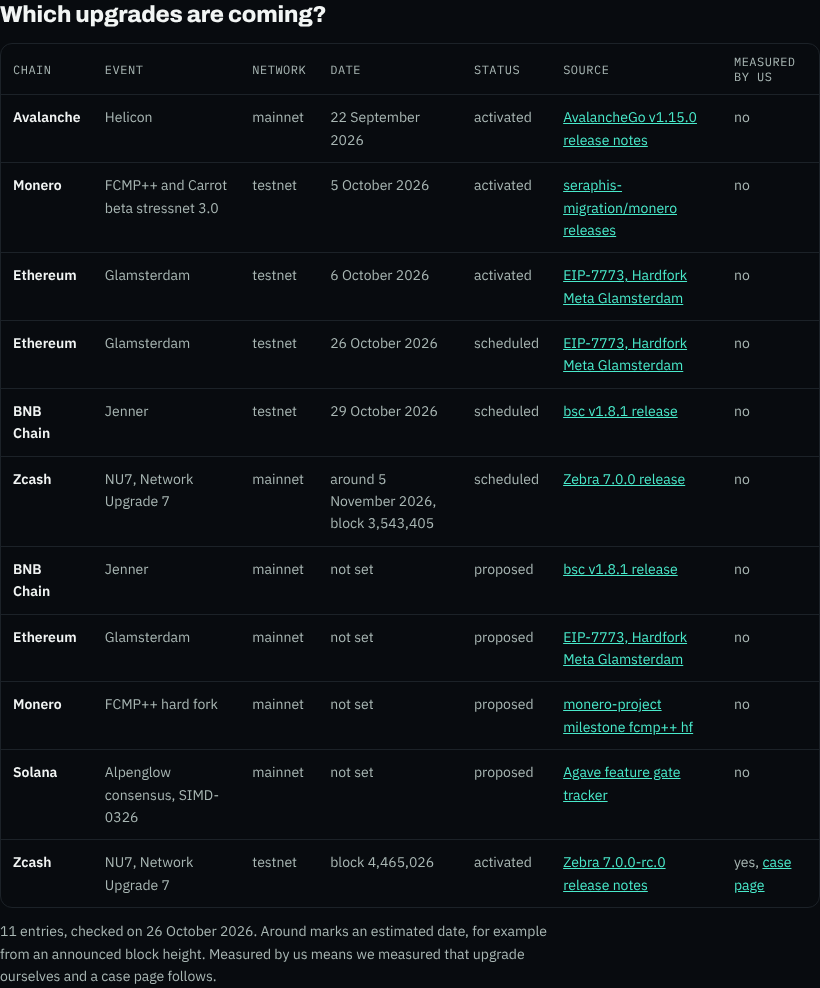
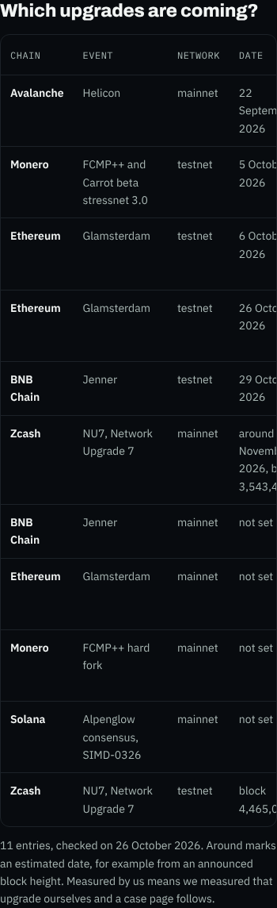

# Bericht 26.10.2026, Kalenderdaten und Montags-Entwurf

Auftrag von Ben vom 26.10.2026. Der Montagslauf von `ph-kalender.yml` hat heute keinen Entwurf gebaut ("kein eintrag mit datum in 14 tagen"). Der Grund: `data/upgrades.json` stand noch auf dem 16.10.

## Was gemacht wurde

### `data/upgrades.json`
`updated` ist jetzt 2026-10-26, und jeder geänderte oder neue Eintrag trägt `checked` 2026-10-26.

| Eintrag | Änderung |
|---|---|
| `zcash-nu7-mainnet` | Höhe 3,543,405. Datum 2026-11-05, als Schätzung markiert. Status `scheduled`. Quelle "Zebra 7.0.0 release". Notiz wie vorgegeben. |
| `ethereum-glamsterdam-hoodi` | neu. Testnet, 26.10.2026, `scheduled`. Quelle EIP-7773, Epoche 132352, 17:42:48 UTC. |
| `bnb-jenner-chapel` | neu. Testnet, 29.10.2026, `scheduled`. Quelle "bsc v1.8.1 release", 02:30 UTC, Zeitstempel 1793241000. |
| `bnb-jenner-mainnet` | neu. Mainnet, `date` null, `proposed`, gleiche Quelle. Notiz "No mainnet activation time in bsc v1.8.1." |
| `ethereum-glamsterdam-mainnet` | Die Notiz sagte noch "Hoodi and mainnet activation rows are still blank". Sie lautet jetzt "The mainnet activation row is still blank in EIP-7773.", `checked` 2026-10-26. |

Quai Polaris ist nicht aufgenommen.

Zwei neue, freiwillige Felder:
- **`date_estimate: true`**: Das Datum ist eine Schätzung. `/upgrades` zeigt dann "around 5 November 2026, block 3,543,405". Der X-Entwurf schreibt "around 5 november 2026", die Grafik "around 5 Nov 2026". Unter der Tabelle steht dazu der Satz "Around marks an estimated date, for example from an announced block height."
- **`x_event`**: Das ist ein kurzer Name, nur für den X-Entwurf. Zcash hat `"x_event": "NU7"`. Mit dem langen Namen "nu7 network upgrade 7" kam der Post auf 295 Zeichen. Er hätte dann die Zcash-Zeile in "and 1 more on the calendar" versteckt, die Zcash-Konten aber trotzdem markiert. Mit "NU7" passen alle drei Zeilen, der Post hat 274 Zeichen.

### Quellen gegengelesen
github.com und eips.ethereum.org sind aus der Claude-Umgebung gesperrt. Gelesen habe ich deshalb die Rohdateien auf raw.githubusercontent.com.
- Zebra v7.0.0, `zebra-chain/src/parameters/constants.rs`: Mainnet `NU7: Height(3_543_405)`.
- EIP-7773: Hoodi, Epoche 132352, 1793036568 (2026-10-26 17:42:48 UTC). Die Mainnet-Zeile ist leer.
- bsc v1.8.1, `params/config.go`: Chapel `JennerTime: 1793241000`, das ist 2026-10-29 02:30 UTC. BSC-Mainnet hat `JennerTime: nil`.

### Code
- `scripts/b2b_pages.py`: "around" vor einem geschätzten Datum, dahinter die Höhe. `lastmod` von `/upgrades` folgt jetzt dem Kalenderstand. Die übrigen Zeilen der Tabelle bleiben, wie sie waren.
- `scripts/ph_kalender_post.py`: "around" im Post und in der Grafik, dazu `x_event`. Die Datumsspalte der Grafik ist breiter, sonst stieß "around 5 Nov 2026" an "Zcash".

## Ergebnisse
- **`/upgrades`:** NU7 Mainnet zeigt "around 5 November 2026, block 3,543,405", nicht mehr "not set".
  - `b2b_check` ohne Fund.
  - Kein waagerechtes Scrollen bei 390 und 1280 px.
- **`ph_kalender_post.py --selbsttest`:** 54 von 54 Fällen richtig. Neu sind drei Fälle, für "around" im Post, "around" in der Grafik und `x_event`.
- **Seitenstempel-Selbsttest:** 282 von 282.
- **Secret-Scan:** ohne Fund.
- **Probelauf lokal, Stichtag 2026-10-26, ohne Discord:** 3 Einträge, 274 Zeichen, keine Antwort nötig.

```
network upgrades in the next 14 days, from the pulsehawk calendar

ethereum glamsterdam on testnet, 26 october 2026
bnb chain jenner on testnet, 29 october 2026
zcash nu7 on mainnet, around 5 november 2026

@ethereum @bnbchain @zcash @zcashfoundation
pulsehawk.io/upgrades
```



`/upgrades`, 1280 px und 390 px:





## Lauf auf dem Betriebspfad
Das ist `ph-kalender.yml` per workflow_dispatch mit `heute=2026-10-26`. Es geht erst nach dem Merge, das Ergebnis kommt in einem kleinen Nachtrag.

## Offene Fragen an Ben
1. **Hoodi auf `activated`:** Ab dem 27.10. muss der Status umgestellt werden. Ich lege dafür am 27.10. einen kleinen PR an. Oder soll der Generator `scheduled` mit vergangenem Datum selbst als `activated` zeigen? Davon rate ich ab, weil es dann ohne Quelle geschähe.
2. **`x_event` "NU7":** Ist der kurze Name für den Post so recht?
3. **Testnetz im Namen:** Die Tabelle schreibt bei Ethereum zweimal nur "testnet", für Sepolia und für Hoodi. Soll die Spalte den Namen des Testnetzes zeigen, also "Hoodi testnet" oder "Chapel testnet"?
4. **Prüfdatum:** Die übrigen Einträge (Monero, Avalanche, Solana, Zcash testnet, Sepolia) habe ich nicht neu geprüft, sie behalten `checked` 2026-10-16. Unter der Tabelle steht aber "checked on 26 October 2026", denn die Seite nennt das jüngste Prüfdatum. Soll der Satz stattdessen "last checked" heißen?
5. **`@BNBCHAIN`:** Ist das das offizielle X-Konto?

## Was Ben tun muss
1. PR mergen.
2. Danach startet Claude `ph-kalender.yml` mit `heute=2026-10-26`, oder du startest es selbst unter Actions, "ph kalender entwurf", "Run workflow". Ergebnis prüfen: Entwurf mit Grafik in `#ph-entwuerfe`.
