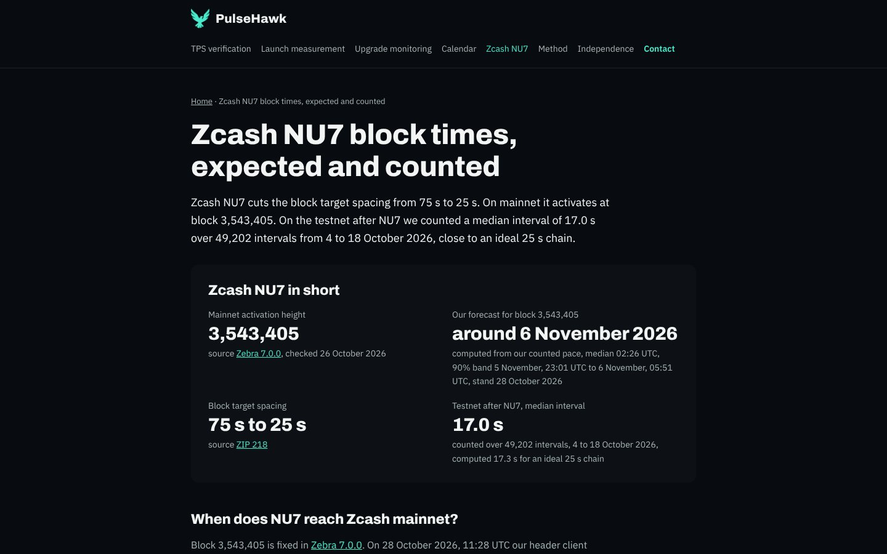
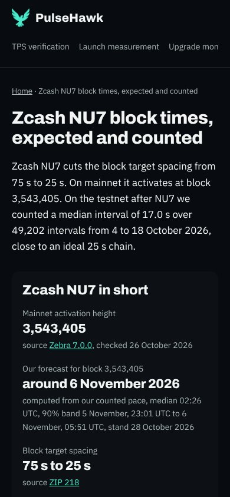

# Bericht SEO /zcash-nu7 (Auftrag 27.10.2026, Frist Mo 2.11. 18:00 Berlin)

Ziel: pulsehawk.io/zcash-nu7 soll vor der Aktivierung am 6.11. (Höhe 3,543,405) die beste Seite für die Suchen "zcash nu7", "zcash nu7 block time" und "zcash block time" sein. Umgesetzt in **#42** (Branch `site/seo-zcash-nu7`).

## Was gemacht wurde

### 1. Title und H1
- **Title:** "Zcash NU7 block times, expected vs counted | PulseHawk", 54 Zeichen, wie vorgeschlagen.
- **H1:** "Zcash NU7 block times, expected and counted".
- **Description:** 153 Zeichen. Sie enthält die Höhe 3,543,405, 75 s auf 25 s, die Prognose und die 500-Block-Spanne.
- **Neuer Lead:** Er beantwortet zuerst die Frage, dann folgen Mainnet-Höhe und die Testnet-Zahl mit Zeitraum.
- **Bezeichnungen im Text:** Im Seitentext steht für Werte einer idealen Kette jetzt überall "computed" statt "expected", für unsere Zählung "counted". Das betrifft die Tabellenköpfe "Counted" und "Computed at 25 s" sowie die Erklärzeile darunter. Das Suchwort "expected" steht nur in Title und H1.

### 2. Kurz-Fakt-Block "Zcash NU7 in short" direkt unter dem Lead
| Fakt | Wert | Kennzeichnung |
|---|---|---|
| Mainnet activation height | 3,543,405 | source Zebra 7.0.0, checked 26 October 2026 |
| Our forecast for block 3,543,405 | around 6 November 2026 | computed from our counted pace, Median 02:26 UTC, 90 % Band 5 November 23:01 UTC bis 6 November 05:51 UTC, stand 28 October 2026 |
| Block target spacing | 75 s to 25 s | source ZIP 218 (im Original auf GitHub gegengelesen) |
| Testnet after NU7, median interval | 17.0 s | counted über 49,202 Intervalle, 4. bis 18.10.2026, computed 17.3 s |

Darunter stehen zwei neue Abschnitte für die Suche "zcash block time":
- **"When does NU7 reach Zcash mainnet?":** Stand der Spitze, fehlende Blöcke, Tempo der letzten 14 vollen UTC-Tage, Median aus 20,000 Ziehungen, 90 % Band und die Rechnung mit genau 75 s. Alles ist als computed gekennzeichnet.
- **"What is the Zcash block time before NU7?":** Mainnet vor NU7, counted gegen computed bei 75 s. Mittel 75.34 s, Median 53.0 s, p90, p99 und die längste Lücke über 43,793 Intervalle vom 20.9. bis 28.10.2026.

**Woher die Zahlen kommen:**
- Sie stammen aus dem jüngsten Stand auf `messung/zcash-mainnet` in kaspa-pulse.
- `scripts/zcash_stand.py` macht daraus eine gekürzte Kopie, `data/zcash-nu7/mainnet-stand.json`. Peer-Software und die Zakura-Schätzung bleiben draußen, Zakura steht nirgends auf der Seite.
- **Die Seite nutzt `stand-2026-10-28`.** Der Bot hat ihn am 28.10.2026 um 11:32 UTC geschrieben, Stand der Spitze 11:28 UTC bei Block 3,533,510. Ich habe ihn mit `zcash_stand.py` übernommen und die Seite neu gebaut.
- **Median mit einer Nachkommastelle:** Im neuen Stand ist der Mainnet-Median eine ganze Zahl (53). Der Generator schreibt Mediane deshalb immer mit einer Nachkommastelle, damit in der Tabelle 53.0 s neben den berechneten 52.0 s steht.

### 3. FAQ mit FAQPage-Schema
Die vier Fragen stehen wörtlich wie vorgegeben, die Antworten enthalten nur unsere Zahlen und Quellen:
1. **When does Zcash NU7 activate?** Höhe aus Zebra 7.0.0, unsere Prognose mit Band. Nach der Aktivierung wechselt die Antwort auf "activated, we counted that block at …".
2. **What is the Zcash block time after NU7?** 75 s auf 25 s (ZIP 218), Testnet counted Mittel 23.68 s und Median 17.0 s. Ab der Aktivierung kommt der Mainnet-Median dazu.
3. **How long do 500 blocks take after NU7?** 12,500 s, also etwa 3.5 h, computed. Testnet counted Median 3.46 h über alle 500er-Strecken vom 4. bis 18.10. Bei 75 s etwa 10.4 h, computed.
4. **Did the NU7 testnet hit 25 second blocks?** Mittel 23.68 s gegen 25 s, Median 17.0 s gegen 17.3 s.

Die zwei alten Fragen (verwaiste Blöcke, Bestätigungen) sind aus dem FAQ entfernt. Sonst wäre der Abschnitt über 250 Wörter gekommen. Die Antworten stehen weiter in den Abschnitten #orphaned und #confirmations.

### 4. Schema und Sitemap
- **Article:** `dateModified` ist das jüngere Datum aus Textstand und Mainnet-Stand. Jedes neue Holen eines Stands setzt es also neu.
- **Dataset:**
  - `temporalCoverage` ist jetzt der echte Zeitraum 2026-10-04T18:21:45Z bis 2026-10-18T05:59:48Z, vorher "../2026-10-18".
  - `distribution` zeigt auf die CSV, Lizenz CC BY 4.0.
- **Sitemap:** `lastmod` für /zcash-nu7 ist 2026-10-28.
- **FAQPage und BreadcrumbList** kommen aus denselben Daten wie der sichtbare Text. `b2b_check` vergleicht sie.

### 5. Ab der Aktivierung: "First counted numbers after activation"
- **Auslöser:** Sobald der Stand einen Teil `nach_nu7` hat, baut der Generator selbst um. Das ist die "Kurznotiz nach nu7", die `zcash-mainnet.yml` in kaspa-pulse beim ersten Lauf nach NU7 schreibt.
- **Was sich dann ändert:**
  - Der Fakt-Block zeigt "NU7 activated on mainnet" mit der gezählten Zeit des ersten NU7-Blocks und den Mainnet-Median nach NU7.
  - Der neue Abschnitt bringt Mittel, Median, p90, p99 und die längste Lücke, counted gegen computed bei 25 s, dazu das Einpendeln der Schwierigkeit.
  - Prognose und Vor-NU7-Abschnitt fallen weg.
  - `dateModified` und `lastmod` springen auf das Datum des Stands.
- **Getestet:** mit einem erfundenen Stand nach NU7. Alle Textregeln sind eingehalten, jede Zahl hat Datum und Kennzeichnung.
- **Ablauf am 6.11.:** Nach dem Lauf in kaspa-pulse (täglich 05:23 UTC) hole ich den Stand mit `scripts/zcash_stand.py`, baue neu und merge selbst.

### 6. Marke und Regeln
Kopf mit Falke und das OG-Bild sind neu gerendert (Title und H1 haben sich geändert), Farben und Schriften wie bisher. Keine Preise, die Textregeln sind eingehalten.

## Prüfungen
- **Textregeln:** `b2b_check` 0 von 12 Seiten mit Fund. Die Archivseite leitet seit #43 weiter und zählt nicht mehr mit.
- **Lighthouse lokal, /zcash-nu7:** 100/100/100/100 auf Handy und Desktop, **SEO 100**. LCP 1.654 ms auf dem Handy und 431 ms am Desktop, wie vorher.
- **Screenshots** 390 und 1440 px stehen unten, neu aufgenommen mit dem Stand vom 28.10. Kein waagerechtes Scrollen.
- **Rich Results Test (Google):** aus der Claude-Umgebung nicht erreichbar (Proxy). Die Schemas habe ich lokal geprüft:
  - FAQPage hat 4 Fragen mit Antworttext, beide wörtlich sichtbar.
  - Article hat headline, image, datePublished, dateModified und author.
  - Dataset hat name, description, license, temporalCoverage und distribution.
  - Den echten Test auf der Live-URL macht Ben, siehe unten.
- **Secret-Scan:** ohne Fund.

Ganze Seite: [1440 px](2026-10-29-seo-zcash-nu7/zcash-nu7-1440.jpg), [390 px](2026-10-29-seo-zcash-nu7/zcash-nu7-390.jpg).

## Selbst-Merges
| PR | Merge-Commit | Was live ist | Abnahme auf der echten URL |
|---|---|---|---|
| #44 | `0ddfdd2` | Nur ein Bericht (Live-Prüfung der Weiterleitungen aus #43), keine Seite | entfällt, keine Seite geändert |

## Offene Fragen an Ben
1. **"Kurznotiz vom 6.11.":** Ich verstehe darunter den ersten Stand mit `nach_nu7`, den `zcash-mainnet.yml` als "kurznotiz nach nu7" schreibt. Stimmt das?
2. **FAQ-Snippets:** Google zeigt FAQ-Rich-Snippets seit 2023 fast nur noch für Behörden- und Gesundheitsseiten. Das Schema ist trotzdem gültig und hilft Suchmaschinen und KI-Antworten. Erwartest du ein sichtbares FAQ-Snippet in der Suche?
3. **Automatisch holen:** Soll ein kleiner Workflow den Mainnet-Stand täglich holen und die Seite neu bauen? Das wäre eine Workflow-Änderung, also Ben merged. Bis dahin hole ich ihn am 28.10. und am 6.11. von Hand.

## Was Ben tun muss
1. Nach dem Merge Googles Rich Results Test mit der URL https://pulsehawk.io/zcash-nu7 laufen lassen.
2. Frage 1 und 3 beantworten.
