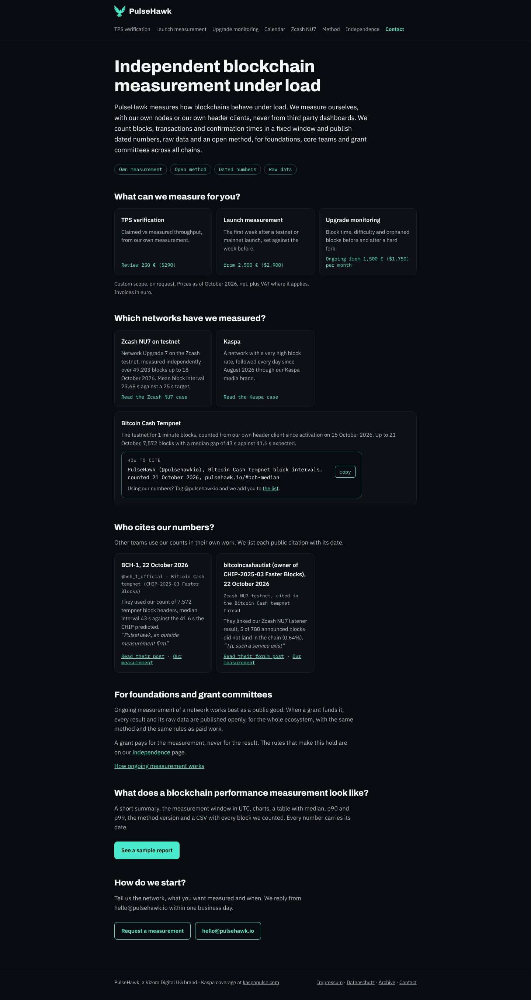
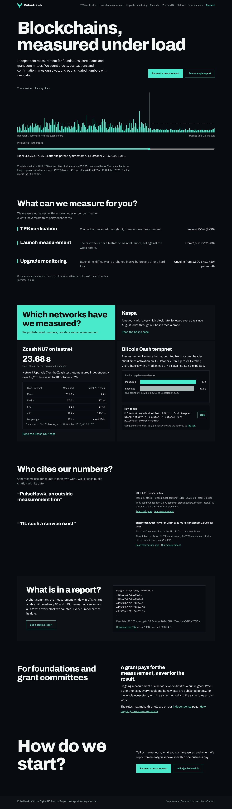
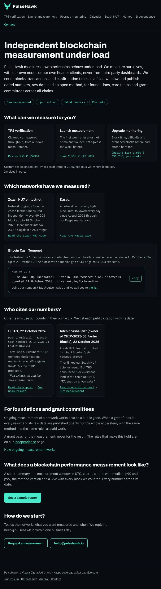
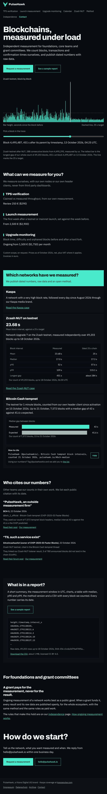
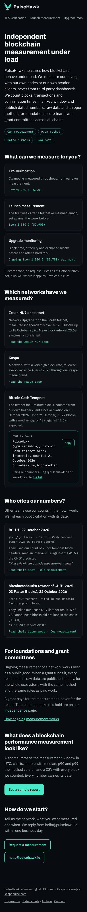
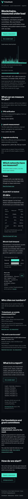

# Bericht 26.10.2026, Startseite mit dem Design-Skill

Auftrag von Ben vom 26.10.2026 ("beide Seiten schnellstmöglich top notch"), Frist Do 29.10. 18:00 Berlin. Umgesetzt in **#38** (Branch `site/taste-startseite`), offen. PR #37 (Kalenderdaten) hatte Vorrang und wartet nur noch auf den Merge.

## Was gemacht wurde

### 1. Skill eingebunden
- **Ablage:** `.claude/skills/design-taste-frontend/`. Das ist eine unveränderte Kopie von `skills/taste-skill` aus `leonxlnx/taste-skill`, fest auf Commit `12af471f627f866411b4bd785b19646d3672784c`.
- **Lizenz und Herkunft:** Die MIT-`LICENSE` liegt dabei. `HERKUNFT.md` nennt Commit, Lizenz, deine Regeln und die Prüfung vor dem Einbinden.
- **Nicht auf der Website:** `_config.yml` schließt `.claude` und `.taste-skill` aus. Die Arbeitsdateien des Skills (`.taste-skill/`) stehen in `.gitignore`.
- **Geprüft vor dem Einbinden:**
  - Die Skripte laden nur aus öffentlichen Bildarchiven, ohne Schlüssel.
  - Prüfer und Browser laufen nur auf dem eigenen Rechner.
  - Es gibt keine Installation und keine Abhängigkeiten.
  - Im Code stehen keine IPs außer der Loopback-Adresse.
  - Der Secret-Scan findet nichts.
- **Kein Update** auf einen neueren Stand ohne neue Prüfung durch Claude.

### 2. Audit (Prüfskript des Skills, 1440, 768 und 390 px)
Vorher, Stand main am 26.10.2026. `lint.mjs` meldet auf allen fünf Seiten 0 FAIL und 0 WARN. `inspect.mjs`:

| Seite | FAIL | WARN |
|---|---|---|
| Startseite | 8 | 7 |
| /launch-measurement | 8 | 7 |
| /zcash-nu7 | 7 | 6 |
| /upgrades | 6 | 8 |
| /independence | 5 | 6 |

**Maßstab:** Versteht ein Builder oder eine Foundation in 5 Sekunden, wer wir sind, was wir messen und für wen, und sieht sofort einen Beweis? Befunde nach Wirkung sortiert:

1. **Kein Beweis im ersten Bild.** Auf keiner der fünf Seiten steht eine Zahl mit Datum oder ein Fall im ersten Screen. Ausnahme ist /zcash-nu7, dort steht der Beweis im Text. Die Zcash-Zahl der Startseite kam erst nach einem ganzen Screen.
2. **"Für wen" steht im Kleingedruckten.** Auf der Startseite stand es erst im fünften Satz eines Leads mit 60 Wörtern.
3. **Keine Aktion im ersten Bild.** Auf allen fünf Seiten gab es im ersten Screen keinen Knopf.
4. **Kein Schwerpunkt.** Die H1 hatte 46 px (3,2 vw), und es gab kein Bild. Auf dem Handy brach die Startseiten-H1 auf 4 Zeilen um, die längste H2 auf 3.
5. **Handy-Navigation abgeschnitten.** "Upgrade mon…" endet am Bildrand, auf allen Seiten. Auf /upgrades scrollt die Tabelle auf dem Handy seitwärts.
6. **Laufschrift klein und grau.** Sie hatte 14,5 px. /zcash-nu7 hat 8 Textblöcke unter 13 px (die Quellenzeilen). Monospace für Chips, Preise, Tabellenköpfe und Quellen.
7. **Linien statt Flächen.** Linien unter Kopf, über dem Fuß und zwischen den FAQ, umrandete Karten, Karten in Reihen.
8. **Leere Flächen.** Auf /upgrades sind 2 von 3 Desktop-Screens fast leer. /launch-measurement hat eine leere Fläche von 29 % im ersten Screen und ein Eyebrow-Label über dem Preis.
9. **Keine Bewegung, kein Bild.** Die Seiten haben 0 Bilder und 0 bewegte Elemente.

### 3. PR 1, nur Startseite (#38)
- **Richtung:** "One motif" (Seed 1703808810), mit `--keep palette,type`, also Farben und Schriften der Marke.
- **Idee:** Auf der Seite wird der echte Abstand zwischen zwei Zcash-Blöcken, der Puls, den PulseHawk misst, zum einzigen Motiv: ein senkrechter Balken. Er ist das große Bild im Hero, der Punkt vor jeder Leistung und der Balken im Bitcoin-Cash-Vergleich.
- **Das eine Interaktive:** Ein Regler geht durch 288 echte Blöcke. Er zeigt Höhe, Abstand und Zeit in UTC. Ohne JavaScript zeigt er die längste Lücke.
- **Aufbau, von oben:**
  1. H1 "Blockchains, measured under load".
  2. Ein Satz zu "für wen und was". Daneben "Request a measurement" (gefüllt) und "See a sample report" (Rahmen, mit Plausible-Klasse "Sample Report").
  3. Darunter die Pulslinie: 288 Blöcke ab Höhe 4,495,295, mit der längsten Lücke der ganzen Zählung (451 s, Block 4,495,487, 13.10.2026, 04:25 UTC). Die Daten kommen beim Bauen direkt aus der CSV im Repo, nichts ist abgetippt.
  4. Leistungen als Preiszeilen: Name, ein Satz, Preis. Gleicher Text, gleiche Preise.
  5. Netzwerke als Kacheln. Die Überschrift steht auf einer Teal-Fläche.
     - Zcash mit 23.68 s groß und der Tabelle "measured vs ideal".
     - Bitcoin Cash mit Balken 43 s gegen 41.6 s und dem Zitierkasten (Anker `#bch-median` bleibt).
     - Kaspa unverändert.
  6. Zitate als Zeilen: das Zitat groß, die Quelle daneben.
  7. "What is in a report?" (vorher "What does a blockchain performance measurement look like?", auf dem Handy 3 Zeilen). Daneben die ersten Zeilen der echten CSV mit SHA-256 und Download (Klasse "CSV Download").
  8. Förderer als Aussage: "A grant pays for the measurement, never for the result."
  9. Abschluss "How do we start?" groß, mit Kontakt.
- **Bewegung:**
  - Die Balken steigen beim Laden.
  - Die Teile jedes Abschnitts kommen gestaffelt herein.
  - Die Knöpfe reagieren auf Klick.
  - Es bewegen sich nur `transform` und `opacity`.
  - Bei reduzierter Bewegung, ohne JavaScript und beim Sprung auf einen Anker bleibt alles sofort sichtbar.
- **Text:**
  - **Keine neue Aussage:** Jeder Satz und jede Zahl stand vorher schon auf der Startseite oder auf /zcash-nu7. Neu sind nur Beschriftungen (Achsen, Regler).
  - **Preise:** unverändert.
  - **Textregeln:** `b2b_check` meldet auf 13 von 13 Seiten nichts.
- **Getrennt vom Rest:**
  - CSS und Skript stehen nur in `index.html` (`body.home`). Die anderen 12 Seiten sind Byte für Byte gleich.
  - Keine externen Skripte oder Schriften.
  - Neu sind `og/home.png`, weil sich die H1 ändert, und die H1 in `llms.txt`.
- **Bildregister:** Kein fremdes Bild ist eingebaut. Alle Bilder sind Ausschnitte aus unseren eigenen Daten. Das Register lege ich mit dem ersten gefundenen Bild an.

### Messwerte vorher und nachher

| | vorher | nachher |
|---|---|---|
| inspect.mjs | 8 FAIL, 7 WARN | **0 FAIL**, 3 WARN |
| H1 bei 1440, 768, 390 px | 46, 41.5, 30 px, bei 390 px 4 Zeilen | 107, 57, 34 px, überall 2 Zeilen |
| Laufschrift | 14,5 px, grau | 18 px, volle Schriftfarbe |
| Schriftgrößen | 9 | 7 |
| Bilder (Datenausschnitte) | 0 | 4 |
| LCP Handy (Lighthouse lokal, Median aus 3) | 1.651 ms | 1.651 ms |
| LCP Desktop | 431 ms | 431 ms |
| Seitengewicht | 108 kB | 130 kB |
| Lighthouse | 100/100/100/100 | 100/100/100/100 |
| Kontrast, schwächstes Textpaar | 9,1:1 | 9,1:1 (AA verlangt 4,5:1) |

Die drei übrigen WARN:
1. **Dritte Schrift (IBM Plex Mono):** Sie bleibt, weil sie zur Marke gehört. Auf der Startseite steht sie nur noch in Code, also im CSV-Kopf und im Zitiersatz.
2. **Keine Fotos:** Die Bildarchive des Skills sind aus der Umgebung gesperrt (Proxy 403).
3. **Kein Video:** gleicher Grund.

Kritik nach `references/critique.md`, letzte Runde:

```
ROUND 3
Seen in one second: the two-line headline and the teal pulse of real blocks under it.
Idea (one sentence): The real gap between two Zcash blocks becomes the one motif, from hero trace to bullets and bars.
Live thing: the slider through 288 measured blocks, with height, gap and UTC time.
Layout words by section: hero=full / services=list / networks=tiles / citations=rows / report=panel split / grants=statement split / close=statement
Scores: design 7.5 · usability 8 · creativity 7.5 · content 8 → overall 7.7
Caps applied: none from inspect. Strictly read, "fewer than four real photographs" caps design at 6.5, then 7.1 overall. The skill counts interface fragments as pictures for software; there are four.
Top three problems (most visible first):
1. Phone navigation cut off at the right edge (mobile-fold), on every page. Fix: one shared header with a menu, follow-up 1.
2. No photograph or footage. Fix: allow the image archives, then add cc0/pd pictures of the subject's world with credit, follow-up 7.
3. The motif ends at the close. Footer and nav are stock. Fix: with follow-up 1.
```

### Screenshots
Ganze Seite, mit reduzierter Bewegung aufgenommen, damit alles sichtbar ist.

| Breite | vorher | nachher |
|---|---|---|
| 1440 px |  |  |
| 768 px |  |  |
| 390 px |  |  |

### Abweichungen vom Skill, mit Grund
- **Hero-Blaupause** "Tabbed folder stack" nicht übernommen. Sie verlangt fünf farbige Mappen und schmale Versalien, das widerspricht der Marke. Gebaut ist die Hero-Komposition der Richtung selbst: Motiv groß, Überschrift 7,4 vw, links bündig.
- **Leistungen** als Preiszeilen statt "Close-ups on a board". Wir haben drei Leistungen mit Preis und keine Bedienelemente, die man vergrößern könnte.
- **Zitate** als Zeilen in Satzgröße statt "One long letter". Unsere Zitate haben höchstens 8 Wörter.
- **Abschluss** ohne Formular im Satz. Ein zweites Brevo-Formular auf der Startseite wäre neu und müsste neu getestet werden.
- **Fußleiste** bleibt die gemeinsame. Die Variante "Mark built large" bräuchte mehrere Farben.
- **Signaturbewegung** "Index with preview" nicht gebaut. Die Zeilen haben keine Vorschaubilder. Die steigende Pulslinie ist die Signatur.

## Folge-PRs (Ben entscheidet die Reihenfolge)

| Nr. | PR | Inhalt | Aufwand |
|---|---|---|---|
| 1 | Gemeinsamer Rahmen, alle Seiten | Kopf mit "Menu" auf dem Handy statt abgeschnittener Leiste. Rahmen und Abstände wie auf der Startseite. Fuß als Fläche statt Linie. Eckige Knöpfe. Laufschrift 18 px. Mono nur noch für Code. | ½ Tag |
| 2 | /zcash-nu7 | Die Pulslinie über alle 49,203 Blöcke als Hero. Die Tabelle als Datenausschnitt. Quellenzeilen 15 px statt 12,5 px Mono. Ein Knopf im ersten Screen. | ½ bis 1 Tag |
| 3 | /upgrades | Auf dem Handy Zeilen statt seitlich scrollender Tabelle. Die zwei fast leeren Screens füllen. Die H1 sagt, was die Seite ist. | 3 bis 4 h |
| 4 | /launch-measurement | Eyebrow über dem Preis weg. Die leere Fläche im ersten Screen schließen. Ablauf und Preis als Zeilen. FAQ ohne Linien. | 2 bis 3 h |
| 5 | /independence | Die vier Regeln als große Aussagen, Zitate wie auf der Startseite. | 2 h |
| 6 | Übrige Seiten | /tps-verification, /upgrade-monitoring, /method, /cases/kaspa, /contact. Viel erledigt schon Nr. 1, dazu je eine kleine Runde. | ½ Tag |
| 7 | Echte Bilder | cc0/pd-Bilder aus der Welt des Messens (Messgeräte, Belastungsproben, Zeitmessung) mit Bildregister und Nennung im Fuß. Erst möglich, wenn die Archive freigegeben sind. | 2 bis 3 h nach Freigabe |

## Offene Fragen an Ben
1. **H1:** Sie heißt jetzt "Blockchains, measured under load", vorher "Independent blockchain measurement under load". Der lange Satz bricht auf dem Handy in 4 Zeilen um. "Independent" steht jetzt im Satz direkt darunter, und Title und Description behalten das Suchwort. Passt das?
2. **Zwei Knöpfe "See a sample report":** Einer steht im Hero, einer beim Bericht. Beide zählen als "Sample Report" in Plausible. Soll nur der Hero zählen?
3. **Bildarchive freigeben?** Für echte Fotos braucht die Umgebung Zugang zu den Archiven des Skills: Openverse, Wikimedia Commons, Art Institute of Chicago, Metropolitan Museum und Internet Archive. Die genauen Adressen nenne ich dir im Chat, nicht in einer Datei. Ohne Freigabe bleiben die Bilder Ausschnitte aus unseren Daten.
4. **Hostnamen im Skill-Code:** Der eingebundene Skill nennt in seinen Skripten öffentliche Adressen dieser Archive und die Loopback-Adresse für den eigenen Rechner. Das sind keine Adressen von uns. Ist das so in Ordnung?
5. **Safari:** Regler und "copy" sind nur in Chromium geprüft. In der Umgebung gibt es kein WebKit.

## Was Ben tun muss
1. #38 ansehen, vorher/nachher stehen oben. Auf dem Handy den Regler ausprobieren. Dann mergen.
2. Die Fragen 1 bis 4 beantworten.
3. Die Reihenfolge der Folge-PRs festlegen.
4. Wenn Bilder gewünscht sind, die Archive freigeben. Das geht in den Einstellungen der Umgebung: Menü in der Titelleiste der Sitzung, "Edit", "Network access", dort die Adressen aus dem Chat unter "Allowed domains" eintragen. Anleitung: https://code.claude.com/docs/en/cloud-environments#network-access

Claude prüft, Ben merged. Keine Schlüssel, Tokens, IPs oder Hostnamen in Dateien. Repo öffentlich.
