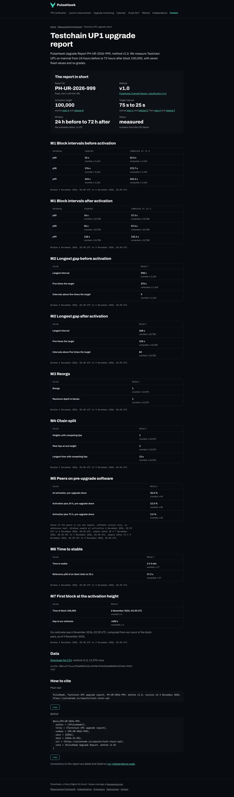
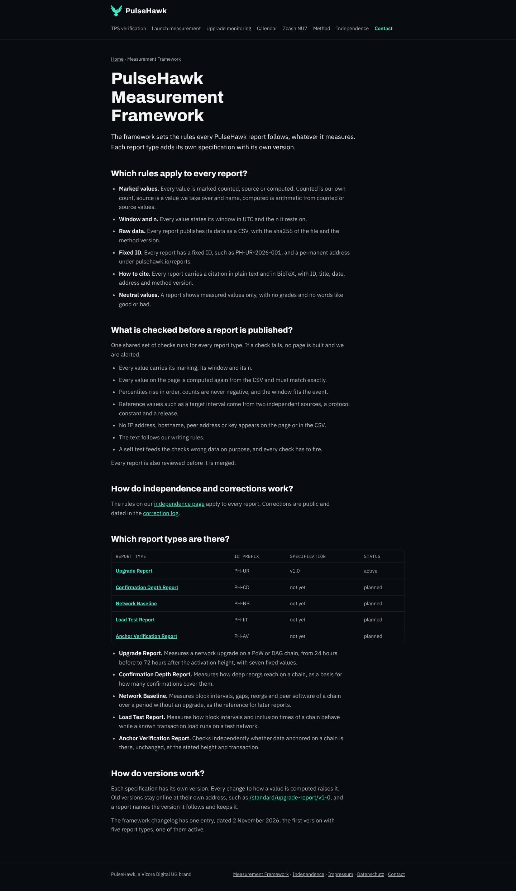
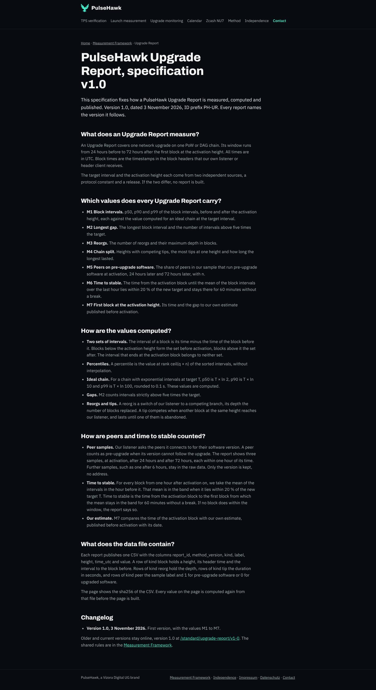
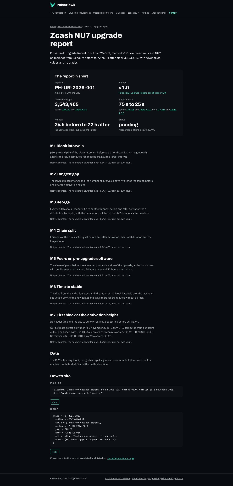
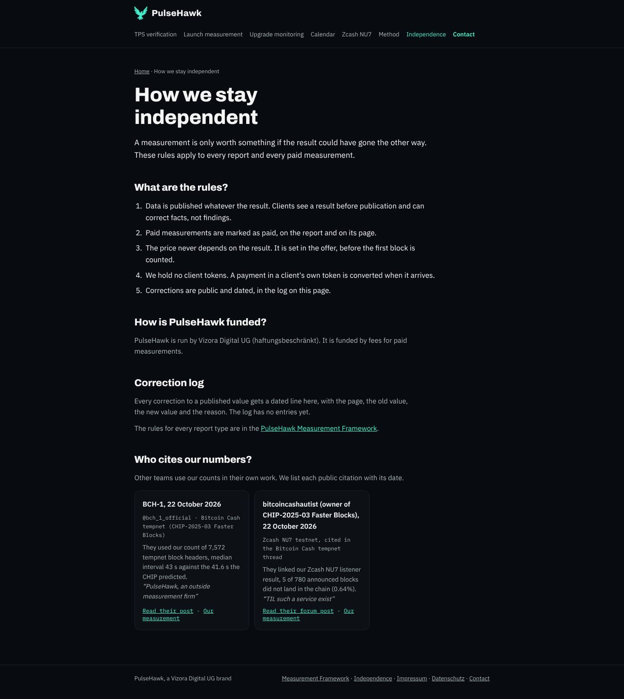

# Bericht 2.11.2026, PulseHawk Measurement Framework und Upgrade Report v1.0

Auftrag von Ben vom 2.11.2026, mit der Ergänzung "Measurement Framework" vom selben Tag. Frist Do 5.11. 18:00 Berlin. Damit soll Zcash NU7 als erster Report im Format erscheinen; die Aktivierung ist um den 6.11. geschätzt. Umgesetzt in **#52** (Branch `site/upgrade-report-standard`).

- **Workflows:** Keine Workflow-, deploy- oder c2-Datei ist geändert.
- **Wer merged:** Ben, nach Claudes Prüfung (Entscheidung vom 3.11.). Kein Selbst-Merge.

## Was gemacht wurde

### Seiten
| Adresse | Inhalt | Index |
|---|---|---|
| /standard/ | "PulseHawk Measurement Framework". Die gemeinsamen Regeln, die gemeinsamen Prüfungen, Unabhängigkeit und Korrekturen, die fünf Report-Typen mit Präfix, Version und Status, Versionsregel, Changelog | ja, Sitemap |
| /standard/upgrade-report/ | "PulseHawk Upgrade Report, specification v1.0", M1 bis M7, Rechenregeln, CSV-Format, Changelog | ja, Sitemap |
| /standard/upgrade-report/v1-0 | Version 1.0 als feste Fassung. Sie bleibt unverändert online, wenn es v1.1 gibt | noindex |
| /standard/confirmation-depth/, /network-baseline/, /load-test/, /anchor-verification/ | geplante Typen, je ein Satz, Präfix, Status planned, ohne Termin und ohne Messwerte | noindex |
| /reports/zcash-nu7 | PH-UR-2026-001, Gerüst ohne Zahlen. Er zeigt Kopf, Quellen und M1 bis M7 mit "Not yet counted", die Schätzung bei M7 und "How to cite" | ja, Sitemap |
| /independence | neu, kurz: fünf Regeln, Finanzierung, Korrekturlog (leer), die Liste "Who cites our numbers?" bleibt | ja |

- **Fußzeile:** Auf allen Seiten stehen jetzt "Measurement Framework" und "Independence".
- **Schema:** Article auf allen neuen Seiten, mit Uhrzeit und Zeitzone. Report-Seiten haben zusätzlich ein Dataset mit `identifier`, `version` (Methode), `license` und `variableMeasured`. Sobald die CSV liegt, kommen `temporalCoverage` und `distribution` dazu.
- **Falke:** wie überall. Die Kaspa-Pulse-Marke steht auf den neuen Seiten nicht (siehe Frage 3).

**Warum mit Schrägstrich am Ende:** /standard/ liegt als `standard/index.html` vor. Gäbe es `standard.html` und den Ordner `standard/` nebeneinander, würde GitHub Pages /standard als Ordner behandeln. Der Aufruf von pulsehawk.io/standard leitet auf /standard/ weiter.

### Die Messwerte des Upgrade Report v1.0
- **M1 bis M7:** wie im Auftrag.
- **Fenster:** vom Block auf der Aktivierungshöhe aus gerechnet, 24 h davor bis 72 h danach.
- **Rechenregeln, festgelegt in der Spezifikation:**
  - **Perzentile:** nach dem nächsten Rang, Wert an Stelle ceil(q × n), ohne Interpolation. Das ist ganzzahlig und exakt nachrechenbar.
  - **Ideale Kette:** p50 = T × ln 2, p90 = T × ln 10, p99 = T × ln 100, auf 0.1 s gerundet, als computed.
  - **Zwei Mengen:** Abstände vor und nach der Aktivierung. Der Abstand, der am Aktivierungsblock endet, gehört zu keiner.
  - **M2:** Abstände strikt über 5 × T.
  - **M5:** drei Proben, jeweils höchstens 1 h neben ihrem Zeitpunkt. Nur die Softwareversion zählt, keine Adresse.
  - **M6:** Zur Abweichung von deinem Text siehe Frage 1.
  - **M7:** Zeit des Aktivierungsblocks und Abstand zu unserer Schätzung. Die Schätzung trägt ihr Datum.

### Quellen, je zwei unabhängige (Prüfung d)
Alles am 2.11.2026 im Original gelesen:

| Wert | Protokoll-Konstante | Release |
|---|---|---|
| Aktivierungshöhe 3,543,405 | ZIP 259, ACTIVATION_HEIGHT (NU7) Mainnet 3543405 | Zebra 7.0.0, Changelog "activates at height 3,543,405" |
| Zielabstand vorher 75 s | ZIP 208, PostBlossomPoWTargetSpacing := 75 | Zebra 7.0.0, `POST_BLOSSOM_POW_TARGET_SPACING = 75` |
| Zielabstand nachher 25 s | ZIP 218, PostNU7PoWTargetSpacing := 25 | Zebra 7.0.0, `POST_NU7_POW_TARGET_SPACING = 25` |

### Der Wächter, einmal für alle Typen
- **Gemeinsamer Teil, `scripts/report_waechter.py`:**
  - Kopfdaten, Report-ID, Quellen;
  - Prüfungen a) bis f);
  - "How to cite";
  - Meldung nach #ops-log;
  - Selbsttest g).
- **Typ-Teil, `scripts/upgrade_report.py`:** Er rechnet nur M1 bis M7 und baut den Inhalt. Ein neuer Typ bekommt ein eigenes Modul mit denselben Funktionen, der Wächter bleibt derselbe.
- **Einbindung in den Bau:** `b2b_pages.py` ruft den Wächter für jede Datei unter `data/reports/` auf.
- **Bei Rot:** Der ganze Bau bricht ab, und die Meldung geht über `scripts/ph/ops_melden.py` (neu mit Art `log`, Secret `DISCORD_WEBHOOK_LOG`) nach #ops-log. Ohne Secret steht sie im Job-Log.

| Prüfung | Was sie tut |
|---|---|
| a | Jeder Wert auf der Seite hat `data-k` (counted, source, computed), `data-n` und ein UTC-Fenster. Kennung und n stehen sichtbar neben dem Wert, das Fenster sichtbar im Abschnitt |
| b | Alle Werte werden aus der CSV neu gerechnet. Sie müssen exakt mit den Werten der messenden Sitzung (`werte` in der JSON) übereinstimmen und auch mit jedem Wert auf der fertigen Seite. Ein Gerüst darf keine Messwerte zeigen |
| c | p50 ≤ p90 ≤ p99, keine negativen Zählungen, alte Peers ≤ n. Das Fenster passt zur Aktivierungshöhe, die Blockhöhen sind lückenlos, Block-Abstand und Zeiten stimmen überein. Report-ID im Muster PH-XX-JJJJ-NNN, Präfix passend zum Typ, Methode gleich der aktiven Spezifikation |
| d | Je zwei Quellen mit verschiedener URL, eine Protokoll-Konstante und ein Release, gleiche Werte, mit Prüfdatum |
| e | Keine IPv4 und IPv6, Host:Port oder fremden Hostnamen, keine Schlüssel (Muster aus `secret_scan.py`), in Seite und CSV |
| f | Textregeln aus `b2b_check`, dazu now, live, Preise und "we offer" |
| g | `python3 scripts/report_waechter.py --selbsttest` |

**Ergebnis des Selbsttests g): 42 von 42 Fällen richtig.**
- **Sauber:** Ein sauberer Testdatensatz und das Gerüst gehen durch.
- **Absichtlich falsch:** 27 falsche Varianten lösen ihre Prüfung aus, jede von a) bis f) mindestens einmal. Darunter:
  - ein anderes p90 der Sitzung;
  - ein geänderter Wert auf der Seite;
  - eine Zeile außerhalb des Fensters;
  - ein Release mit anderer Höhe;
  - eine IP;
  - ein Hostname;
  - ein Host:Port in der CSV;
  - ein Token;
  - ein Gedankenstrich, "now", "we offer" und "$".
- **Meldung:** Die rote Meldung nach #ops-log ist getestet.

So sieht ein Report mit Zahlen aus. Das Muster ist aus Testdaten einer erfundenen "Testchain", nur zur Ansicht und nicht auf der Website:

### Was die Sitzung "Zcash NU7 Testnet Messung" liefern muss
`data/reports/README.md` beschreibt es genau:
1. **CSV:** `reports/zcash-nu7.csv`, Spalten `report_id,method_version,kind,label,height,time_utc,value`, Zeilenarten block, reorg, tip und peer.
2. **Kopfdaten:** In `data/reports/zcash-nu7.json` kommen dazu:
   - `csv`;
   - die eigenen Werte unter `werte`;
   - `geaendert`;
   - falls nötig eine neuere `schaetzung` mit Datum.
3. **Bauen:** `python3 scripts/report_waechter.py --pruefen zcash-nu7`, dann `python3 scripts/b2b_pages.py`.

### Weitere Änderungen
- **`scripts/b2b_check.py`:**
  - `pruefe()` nimmt den HTML-Text auch direkt, damit der Wächter vor dem Schreiben prüft.
  - Die Regel gegen "percent" trifft nur noch das ganze Wort. "Percentile" ist ein Fachwort.
- **`_config.yml`:** `data/reports/README.md` geht nicht auf die Website.
- **Neue Datendatei `data/korrekturen.json`:** der Korrekturlog, anfangs leer. Jeder Eintrag hat datum, seite, alt, neu und grund.

## Prüfungen
- **Textregeln:** `b2b_check` 0 von 20 Seiten mit Fund.
- **Wächter:** `report_waechter.py --pruefen` meldet "ok PH-UR-2026-001 zcash-nu7, geruest".
- **Selbsttests:** Wächter 46 von 46 (am 2.11. 42 von 42), `ops_melden.py` 0 Fehler.
- **Screenshots:** 390 und 1440 px aller neuen Seiten, kein waagerechtes Scrollen. Auf der Report-Seite mit Zahlen brach zuerst die sha256-Zeile bei 390 px aus. Das ist behoben.
- **Code und Daten:**
  - `pyflakes` ohne Fund;
  - Sitemap gültig;
  - JSON-LD gültig, Datum überall mit Uhrzeit und Zeitzone;
  - Secret-Scan ohne Fund.

Screenshots (1440 px, ganze Seite):

Die Fassungen für 390 px liegen im selben Ordner.

## Nachtrag 3.11.2026, Bens Entscheidungen eingearbeitet
**Neuer Kopf von #52:**
- Code und Seiten stehen in Commit `b8056ec`.
- Dieser Bericht kommt als Commit danach.
- Den Kopf beim Merge nennt Claude nach dem Merge.

**Merge:** Kein Selbst-Merge, Ben merged nach Claudes Prüfung.

| Nr. | Entscheidung | Umsetzung |
|---|---|---|
| 1 | M6, Mittel der letzten Stunde innerhalb ±20 % von T, stabil ab dem ersten Block, nach dem das 60 min ohne Unterbrechung gilt | `upgrade_report.py` rechnet so, Band 20 s bis 30 s bei T = 25 s. Ein Block zählt nur, wenn die Daten die 60 min danach ganz abdecken. Spezifikation, /standard/upgrade-report/v1-0 und Selbsttest sind angepasst. Die Seite zeigt Zeit bis stabil (counted) und beide Bandgrenzen (computed) |
| 2 | keine Grants auf /independence | "It is funded by fees for paid measurements." Der Lead nennt keinen Grant mehr. Die Startseite spricht weiter Stiftungen und Grant-Gremien als Zielgruppe an, sie behauptet aber keine Finanzierung. Soll das auch weg, sag Bescheid |
| 3 | Kaspa Pulse nirgends auf pulsehawk.io | Raus aus Fußzeile, Organisations-Schema (`sameAs`), `llms.txt`, /independence und der Kaspa-Fallseite. Die Kaspa-Fallseite nennt für 10 Blöcke je Sekunde KIP-14 als Quelle, für die Gebühren Kaspalytics. Die FAQ zu Kaspa Pulse, der Abschnitt "Where can I follow Kaspa?" und der Link auf Rohdaten im kaspa-pulse-Repo sind weg, ebenso ein HTML-Kommentar mit dem Namen. `scripts/` geht nicht mehr auf die Website, weil die Skripte den Namen in Kommentaren tragen. Die Quellangabe in `data/zcash-nu7/mainnet-stand.json` ist neutral. `b2b_check` und der Wächter melden den Namen künftig in jeder Schreibweise, auch im Schema |
| 4 | geplante Typen bleiben noindex | bleibt so |
| 5 | "Our listener asks the peers" | so übernommen. Auch bei Reorgs, Tips und Header-Zeiten steht jetzt "listener" statt "node". Die Proben bei 0, +24 und +72 h stehen im Report. Die Probe nach 6 h ist als Rohzeile `plus_6h` erlaubt, aber nicht in M5 |
| 6 | Schätzung 2026-11-06T02:39:52Z, as of 2026-11-02, Band 00:28:23 bis 05:00:17 UTC | in `data/reports/zcash-nu7.json`. Die Seite zeigt "6 November 2026, 02:39 UTC … with 9 in 10 of our draws between … 00:28 UTC and … 05:00 UTC, as of 2 November 2026" |
| 7 | CSV-Schnittstelle zu `report_v1.py` | `data/reports/README.md` beschreibt beide Dateien und die Zuordnung der Kennzahlen zu `werte`. Siehe die Absätze darunter |

**Wer die Roh-CSV im PH-Format baut, und wo sie liegt:**
- **Wer:** die messende Sitzung in kaspa-pulse, aus denselben Eingängen wie `report_v1.py` (Köpfe, Log, Zustand, Ereignisse der Wache), bis spätestens 9.11.2026.
- **Wo:** kaspa-pulse, Branch `messung/zcash-mainnet`, Datei `data/zcash-mainnet/report/zcash-nu7.csv` mit `.sha256`.
- **Danach:** Eine Sitzung in pulsehawk-site kopiert sie unverändert nach `reports/zcash-nu7.csv` und trägt die Werte aus der Messwert-CSV unter `werte` ein.
- **Warum dort:** Nur die messende Sitzung hat die Rohdaten. Peer-Adressen bleiben so in kaspa-pulse.

**Datum:** Spezifikation v1.0 und Report tragen jetzt den 3.11.2026, den Tag der Entscheidungen. Veröffentlicht ist noch nichts.

### Unterschiede zwischen `report_v1.py` und Spezifikation v1.0, vor dem Merge zu klären
Ich habe `scripts/wache/report_v1.py` gelesen, auf main und auf `wache/report-v1-c2`, Stand 3.11. 11:57 UTC. Prüfung b) vergleicht die Werte der Sitzung **exakt** mit der Rechnung aus der Roh-CSV. Bei diesen Unterschieden bleibt b) rot, und der Report wird nicht gebaut:

| Punkt | `report_v1.py` | Spezifikation v1.0 und `upgrade_report.py` |
|---|---|---|
| M6 Band | Variante "mittel" mit ±10 % (`STABIL_TOLERANZ = 0.10`) | ±20 % nach Entscheidung 1. **report_v1.py muss auf 0.20** |
| M6 Rand | stabil auch, wenn das Band bis zum Ende der Daten hält, selbst wenn weniger als 60 min übrig sind | die 60 min müssen ganz in den Daten liegen |
| M6 Einheit | Minuten, auf 0.1 gerundet | Sekunden, ganzzahlig |
| M1 Perzentile | lineare Interpolation, auf 0.1 s gerundet | nächster Rang, ganzzahlig |
| M1 und M2 Mengen | "nach" zählt den Abstand des Aktivierungsblocks mit. "vor" beginnt mit dem Abstand zu einem Block vor dem Fenster | der Abstand am Aktivierungsblock gehört zu keiner Menge, gerechnet wird nur innerhalb der CSV |
| Fenstergrenze | über die Höhe: der erste Block ab der Zeitgrenze und alles danach | über die Zeit jeder Zeile |
| M3 | getrennt vor und nach der Aktivierung | ein Wert für das ganze Fenster |
| M4 | Dauer der Episoden des Signals "kettenspaltung" (zwei Zweige mit Mindest-Peers und Mindesttiefe), Summe und längste | Höhen mit konkurrierenden Tips, meiste Tips an einer Höhe, längste Dauer |
| M5 | Anteil in Prozent, Peers unter dem Mindestprotokoll, gezählt beim Handschlag | alte Peers durch n, je Peer eine Zeile 1 oder 0 |

**Empfehlung:** Die Spezifikation folgt `report_v1.py`, denn sie beschreibt, was der Zuhörer wirklich messen kann. Das gilt für M3 (vor und nach getrennt), M4 (Episoden des Signals), die Mengen bei M1 und M2 und die Fenstergrenze über die Höhe. Bei den Perzentilen ist beides gut; einer muss nachgeben. `report_v1.py` stellt M6 auf ±20 % und auf die volle Stunde um, mit Sekunden statt Minuten.

Wenn du das so entscheidest, passe ich Spezifikation, Generator und Selbsttest vor dem Merge an. Nach dem Merge wäre es schon v1.1.

## Offene Fragen an Ben
Die Fragen 1 bis 6 vom 2.11. sind mit den Entscheidungen vom 3.11. beantwortet, siehe Nachtrag. Offen ist:
1. **Unterschiede zu `report_v1.py`:** Welche Seite gibt nach, Spezifikation oder `report_v1.py`? Die Tabelle steht im Nachtrag, meine Empfehlung darunter. Das sollte vor dem Merge feststehen.
2. **Startseite:** Soll der Abschnitt "For foundations and grant committees" bleiben?

## Was Ben tun muss
1. In pulsehawk-site das Secret `DISCORD_WEBHOOK_LOG` anlegen (Webhook von #ops-log), unter Settings, Secrets and variables, Actions.
   - **Lokale Läufe:** Läuft der Wächter in einer Claude-Sitzung, steht die Meldung nur im Log.
   - **Workflow:** Soll ein Workflow Reports bauen und melden, wäre das ein eigener PR, den Ben merged.
2. Frage 1 entscheiden, vor dem Merge.
3. #52 nach Claudes Prüfung mergen.
