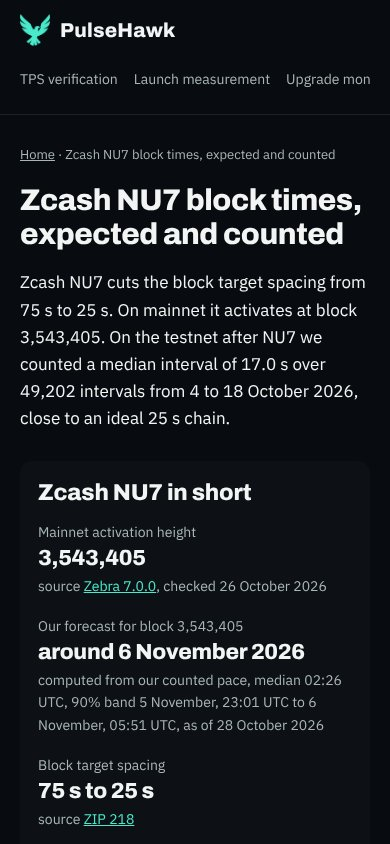
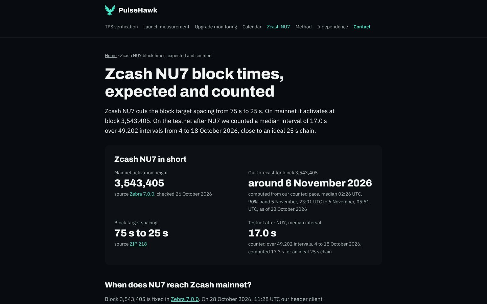

# Bericht 2.11.2026, "as of" statt "stand" auf /zcash-nu7

Auftrag von Ben vom 2.11.2026, Frist Mi 4.11. 18:00 Berlin. Umgesetzt in **#48** (Branch `site/zcash-as-of`).

**Kopf:**
- Code-Commit `54ac842`;
- der Bericht kommt als zweiter Commit dazu;
- den Kopf beim Merge nennt der Abschnitt "Selbst-Merge" unten.

Keine Workflow-Änderung.

## Was gemacht wurde
- **Fehler:** /zcash-nu7 zeigte live an 3 Stellen "stand 28 October 2026". Das ist Deutsch.
- **`scripts/b2b_pages.py`:** "stand <Datum>" heißt jetzt überall "as of <Datum>". Es waren 4 Vorlagen:
  1. Fakt-Block, Prognose: "computed from our counted pace, median …, 90% band … to …, as of 28 October 2026";
  2. Quellenzeile unter "When does NU7 reach Zcash mainnet?": "Our own header client, Zcash mainnet, as of 28 October 2026.";
  3. Quellenzeile unter "What is the Zcash block time before NU7?": "…, blocks 3,489,718 to 3,533,510, as of 28 October 2026.";
  4. Pfad nach NU7 (`nach_nu7`), Quellenzeile unter "First counted numbers after activation": "…, blocks … to …, as of <Datum des Stands>."
- **Im Schema:** Dort stand das Wort nicht. Die FAQ-Antworten und Descriptions enthalten kein "stand".
- **`scripts/b2b_check.py`:** Die Textprüfung meldet jetzt das Wort "stand" im sichtbaren Text, in der Description und im Title. Die Meldung lautet "'stand' in '…', englisch 'as of <datum>'".
  - Wörter wie "standard" oder "understand" zählen nicht.

## Prüfungen
- **Regel greift:** Auf der alten Seite meldet `b2b_check` den Fund "'stand' in 'UTC to 6 November, 05:51 UTC, stand 28 October 2026 …'".
- **Neue Seite:** 0 von 12 Seiten mit Fund. Auf /zcash-nu7 steht 3-mal "as of 28 October 2026" und kein "stand".
- **Pfad nach NU7:** Ich habe ihn mit einem erfundenen Stand vom 6.11. gebaut, der nur lokal lag und nicht im Repo ist. Ergebnis:
  - "First counted numbers after activation" erscheint mit "as of 6 November 2026";
  - kein "stand" auf der Seite, 0 Funde.
  - Danach habe ich die echten Daten wiederhergestellt.
- **Screenshots:** 390 und 1440 px, kein waagerechtes Scrollen.
- **Secret-Scan:** ohne Fund.

Ganze Seite: [1440 px](2026-11-02-zcash-as-of/zcash-nu7-1440.jpg), [390 px](2026-11-02-zcash-as-of/zcash-nu7-390.jpg).

## Folge für #47 (Fallseite Alexandria)
Die Überschrift "Where does the project stand, according to the team?" enthält das englische Verb "stand". Die neue Regel würde sie melden.
- **Vorschlag:** Nach dem Merge hier baue ich #47 auf den neuen main und ändere die Überschrift in "How far has the project come, according to the team?". Sonst ändert sich an #47 nichts.

## Offene Fragen an Ben
1. Ist die Überschrift für #47 so recht?

## Was Ben tun muss
Nichts. Claude mergt selbst nach der Regel und prüft die Live-URL.
