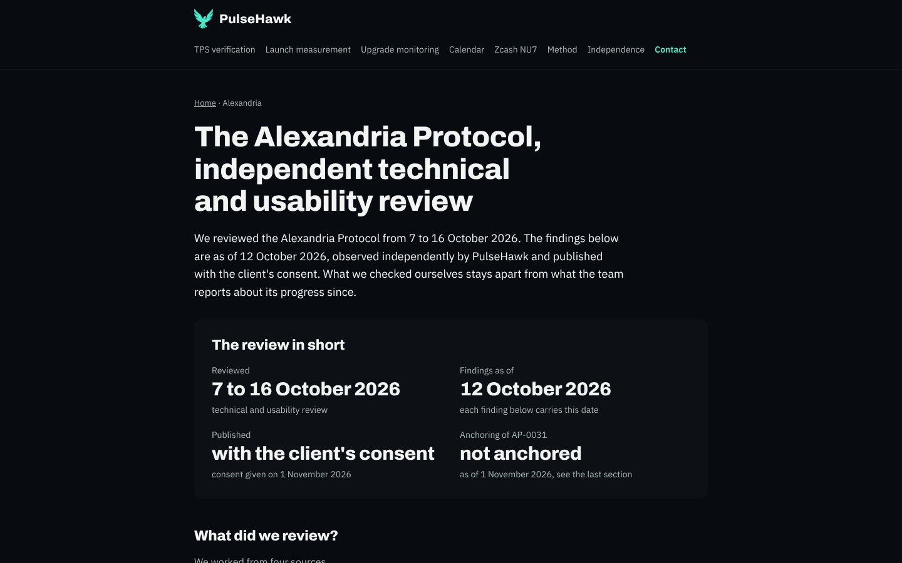
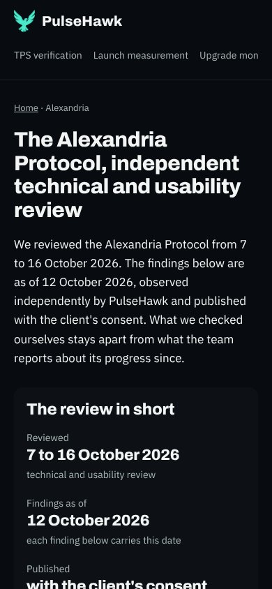
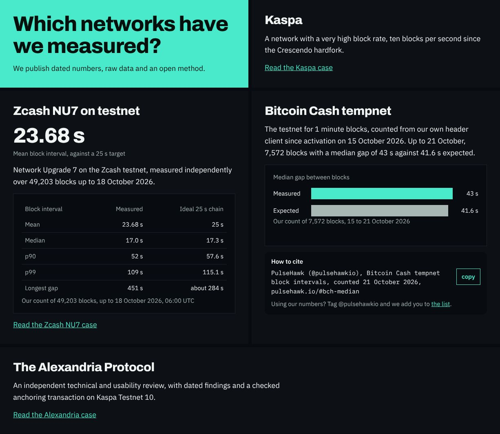

# Bericht 4.11.2026, Fallseite Alexandria

Auftrag von Ben vom 1.11.2026, Frist Mi 4.11. 18:00 Berlin. Umgesetzt in **#47** (Branch `site/fall-alexandria`).

**Claude prüft, Ben merged.** Die Seite geht erst mit dem Merge live, Claude schaltet sie nicht selbst frei.

**Grundlage** ist die Freigabe von Kas Knight per X-DM vom 1.11.2026. Sie erlaubt:
- die Befunde vom 12.10.2026 als unabhängig beobachtet zu veröffentlichen;
- jeden Befund mit Datum;
- den Entwicklungsstand getrennt von den geprüften Ergebnissen;
- mit dem Hinweis, dass AP-0031 noch nicht verankert ist.

## Was gemacht wurde
Die Seite ist **pulsehawk.io/cases/alexandria**. Unter `/cases/alexandria.html` kommt dieselbe Datei.
- **Generator:** Sie wird von `scripts/b2b_pages.py` gebaut, nicht von Hand, im Stil von `cases/kaspa.html`: PulseHawk mit Falke, Brotkrumen, Article-Schema und OG-Bild.

### Aufbau
1. **Kopf**
   - **Title:** "The Alexandria Protocol, independent review | PulseHawk".
   - **H1:** "The Alexandria Protocol, independent technical and usability review".
   - **Lead:** reviewed 7 to 16 October 2026, findings as of 12 October 2026, observed independently, published with the client's consent.
   - **Kasten "The review in short":**
     - Reviewed 7 to 16 October 2026.
     - Findings as of 12 October 2026.
     - Published with the client's consent (consent given on 1 November 2026).
     - Anchoring of AP-0031: not anchored, as of 1 November 2026.
2. **"What did we review?"**
   - der Reviewer Brief mit den Hashes für AP-0030 und AP-0031;
   - die Records AP-0030 und AP-0031;
   - das öffentliche Walkthrough-Video vom 10.10.2026;
   - die öffentliche App, benutzt am 12.10.2026.
3. **"What did we confirm on 12 October 2026?"** Vier Befunde, jeder mit Datum:
   - Download gleicht byte für byte den Hashes im Brief;
   - lokales Hashen im Browser, die Datei verlässt das Gerät nicht;
   - neue Version legt v2 sauber an, v1 bleibt unverändert;
   - zweite Version an derselben Stelle wird blockiert, keine Gabelung.
4. **"What was still open on 12 October 2026?"** Fünf Befunde, jeder mit Datum:
   - gleiche Datei mit anderem Titel als neuer Originaleintrag ohne Warnung;
   - Vertrauensanker ist bis zur Verankerung der Betreiber;
   - ALX-KASPA-1 ohne veröffentlichte Spezifikation und Testvektor;
   - Ankern war für fremde Einträge angeboten;
   - Archivstandards und zweiter Speicher nicht benannt.
5. **"How far has the project come, according to the team?"**
   - **Inhalt:** Kas Knight am 1.11.2026 für das Team: erster Ankerpfad auf TN10 getestet, noch keine Transaktion auf der Kette.
   - **Markierung:** ausdrücklich als Aussage des Teams, "not checked by PulseHawk".
   - **Zusage:** Wir prüfen den ersten Anker unabhängig, sobald er auf der Kette ist.
6. **"Is AP-0031 anchored?"** No, as of 1 November 2026.
   - Danach kommen ein Link auf /independence und der Knopf "Request a review".

### Was nicht auf der Seite steht
- keine Preise;
- keine Rechnungs- oder Firmendaten des Kunden;
- keine Adressen des Kunden;
- keine internen Record-IDs außer AP-0030 und AP-0031.

ALX-KASPA-1 steht drin, weil es im Auftrag als Name des Ankerverfahrens genannt ist. Links auf Seiten des Kunden gibt es keine, weil ich keine Adressen dafür habe (Frage 2).

### Weitere Änderungen
- `sitemap.xml` mit `lastmod` 2026-11-01;
- `llms.txt` mit dem neuen Eintrag;
- OG-Bild `og/alexandria.png`.
- **Kein Link von anderen Seiten:** Startseite und Navigation verlinken die Seite noch nicht (Frage 3).

## Prüfungen
- **Textregeln:** `b2b_check` 0 von 13 Seiten mit Fund.
  - **Nachtrag 2.11.2026:** Seit #48 meldet `b2b_check` das Wort "stand". Die Überschrift von Abschnitt 5 hieß zuerst "Where does the project stand, according to the team?" und heißt jetzt "How far has the project come, according to the team?". Der Branch liegt auf dem aktuellen main, die Seite ist neu gebaut, die Screenshots sind neu. Nach #50 hat auch diese Seite im Schema Uhrzeit und Zeitzone, `2026-11-01T06:00:00+00:00`.
  - **Verbotene Wörter:** "audit", "reviewed by" und "live" stehen nicht im Text, auch "Live-App" nicht. Sie heißt auf der Seite "the public app".
  - **Satzzeichen und Zahlen:** keine Doppelpunkte, Striche, Pfeile, Preise oder Sätze, die mit einer Ziffer beginnen. Die Description hat 149 Zeichen.
- **Screenshots:** 390 und 1440 px, kein waagerechtes Scrollen. Die Listen stehen im Textrand.
- **Sitemap:** parst als gültiges XML.
- **Secret-Scan:** ohne Fund.

Ganze Seite: [1440 px](2026-11-04-fallseite-alexandria/alexandria-1440.jpg), [390 px](2026-11-04-fallseite-alexandria/alexandria-390.jpg).

## Nachtrag 4.11.2026, auf main nach #52
- **Rebase:** Der Branch liegt auf main nach dem Merge von #52 (Measurement Framework). Der einzige Konflikt war `llms.txt`, eine erzeugte Datei. Ich habe sie mit `b2b_pages.py` neu gebaut, nicht von Hand.
- **Fußzeile der Seite:** Sie nennt jetzt "Measurement Framework" und "Independence" und keine Kaspa-Pulse-Marke mehr (Bens Entscheidung vom 3.11.).
- **Prüfungen:**
  - `b2b_check` 0 von 21 Seiten mit Fund;
  - Wächter-Selbsttest 52 von 52;
  - Secret-Scan ohne Fund;
  - die Screenshots 390 und 1440 px sind neu.
- **Neuer Kopf:** steht in der Antwort an Ben und in der PR-Beschreibung.

## Nachtrag 4.11.2026, Bens Antworten eingearbeitet
**Neuer Kopf von #47:**
- Seite, Startseite und Code stehen in Commit `8700abb`.
- Dieser Nachtrag kommt als Commit danach.

**Merge:** Kein Selbst-Merge.

| Nr. | Antwort | Umsetzung |
|---|---|---|
| 1 | "Kas Knight" ist ok, keine bürgerlichen Namen | bleibt so, kein anderer Name auf der Seite |
| 2 | nur die öffentliche Projektseite verlinken | Neuer Satz unter "What did we review?": "The project page of the Alexandria Protocol is the-alexandria-protocol.replit.app." Er verlinkt die Startadresse der App. Kein Video, keine Einzeleinträge. Die Adresse steht in `messung/alexandria/anker.txt` in kaspa-pulse. Aus meiner Umgebung ließ sie sich nicht abrufen, der Proxy lässt sie nicht durch. Bitte einmal im Browser prüfen |
| 3 | Startseite verlinkt auch diesen Fall | Neue breite Kachel "The Alexandria Protocol" unter den Kacheln der gemessenen Netze, mit "Read the Alexandria case". Die Kaspa-Kachel sagte noch "followed … through our Kaspa media brand". Das war ein Hinweis auf Kaspa Pulse und steht jetzt so: "ten blocks per second since the Crescendo hardfork" (Quelle KIP-14, wie auf /cases/kaspa) |
| 4 | "Kaspa Testnet 10 (TN10)" | so übernommen |
| 5 | Datum der Seite ist das Datum des Merges | Article, Sitemap, Kasten "Anchoring of AP-0031" und der Abschnitt "Is AP-0031 anchored?" stehen auf dem 4.11.2026 (Konstante `ALEX_DATUM`). Mergst du später, ändere ich das Datum vorher |

**Abschnitt 5 aktualisiert:**
- **"How far has the project come, according to the team?":** Kas Knight am 1.11.: erster Ankerpfad auf TN10 getestet. Seit 1.11.2026, 21:24 UTC liegt eine Anker-Tx zu study 52 auf TN10.
- **Neuer Abschnitt "What did we check on the anchoring transaction?":** "Checked by PulseHawk on 2 November 2026", nur counted. Er nennt:
  - die angenommene Tx `3db50bc6…0269` im Block `9afd2421…a7d5`, auf zwei öffentlichen TN10-Knoten;
  - die Blockzeit 1.11.2026 21:24:24 UTC;
  - den Payload byte-genau, 85 Byte.
- **Offen benannt:**
  - Eingang und Gebühr sind nicht lesbar, weil die Tx davor älter ist als das, was beide Knoten halten.
  - Das Commitment ist ohne veröffentlichte ALX-KASPA-1-Spezifikation nicht nachrechenbar.
- **Tx-ID und Blockhash:** Sie stehen ganz da, in kleiner Schrift, bei 390 px umbrochen.
- **Keine Adressen:** Auf der Seite steht keine Adresse.
- **Quelle:** kaspa-pulse `berichte/2026-11-03-alexandria-anker.md`.
- **AP-0031:** Der Abschnitt "Is AP-0031 anchored?" sagt dazu, dass die geprüfte Tx study 52 verankert, nicht AP-0031.

**Prüfungen:**
- `b2b_check` 0 von 21 Seiten mit Fund;
- Wächter-Selbsttest 52 von 52;
- Secret-Scan ohne Fund;
- Screenshots 390 und 1440 px neu, kein waagerechtes Scrollen, dazu die Kacheln der Startseite.

## Offene Fragen an Ben
Die fünf Fragen sind am 4.11. beantwortet. Neu ist nur eine Bitte: die Projektseite einmal im Browser öffnen, weil ich sie nicht abrufen konnte.

## Was Ben tun muss
1. #47 prüfen und mergen. Erst damit ist die Seite live.
2. Die Projektseite im Browser prüfen. Beim Merge an einem anderen Tag als dem 4.11. Bescheid geben, dann setze ich das Datum vorher.
3. Nach dem Merge prüft Claude die Seite auf pulsehawk.io und trägt das Ergebnis hier nach.
